# Circuit gallery

Select a drawing to open its full-size input. Each row of the pilot uses the original PNG or the equivalent netlist in the corresponding case folder.

| P01 | P02 | P03 |
| --- | --- | --- |
| [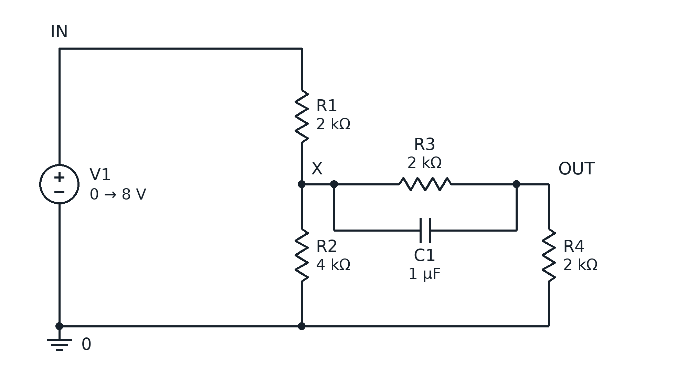](../inputs/P01/schematic.png) | [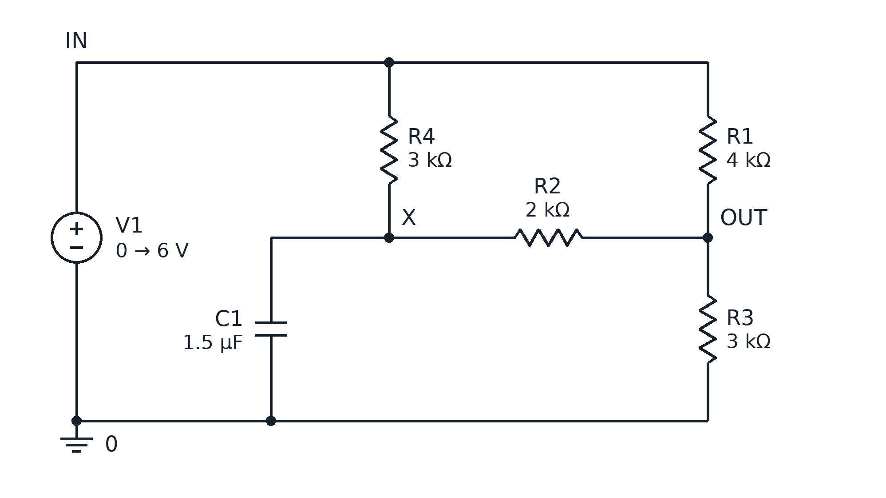](../inputs/P02/schematic.png) | [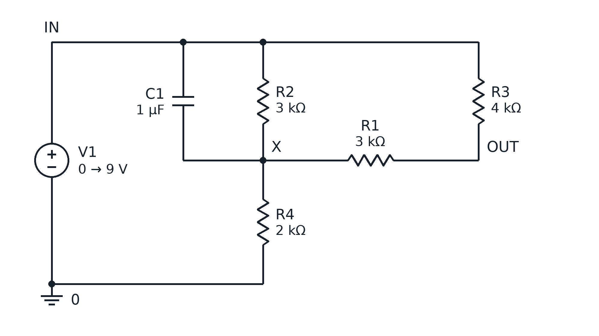](../inputs/P03/schematic.png) |
| **P04** | **P05** | **P06** |
| [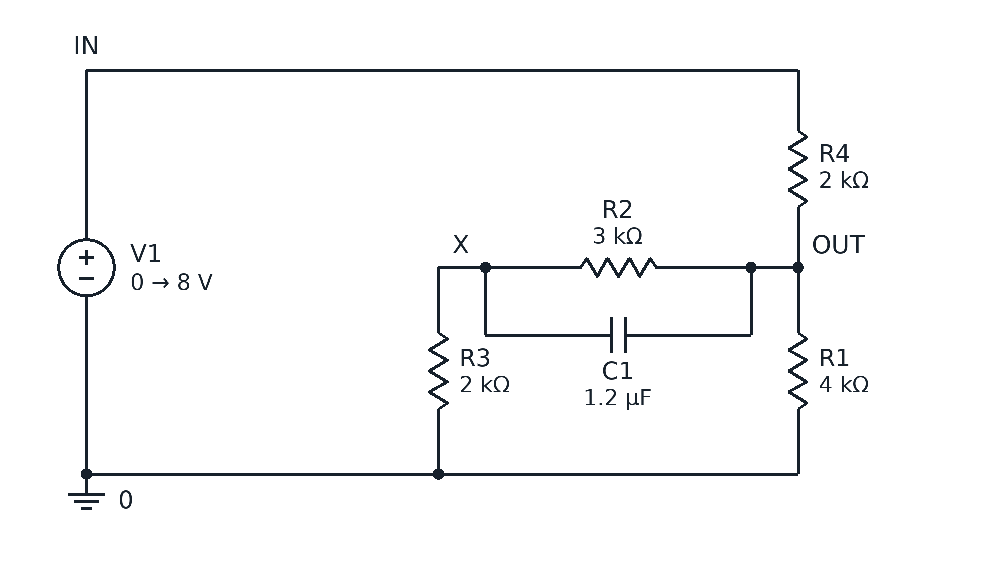](../inputs/P04/schematic.png) | [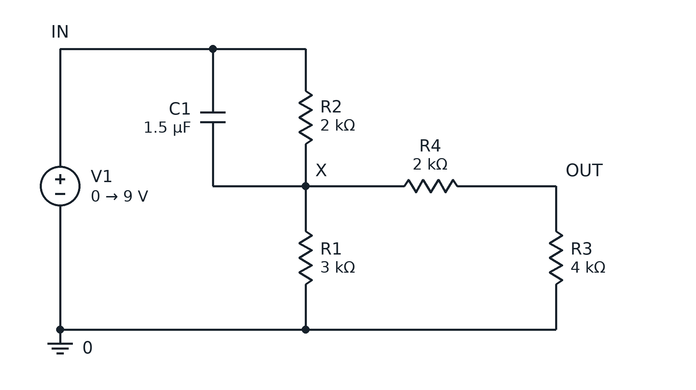](../inputs/P05/schematic.png) | [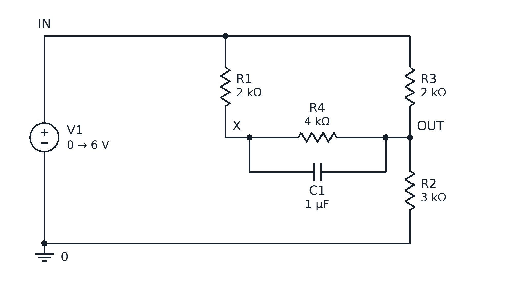](../inputs/P06/schematic.png) |
| **P07** | **P08** | **P09** |
| [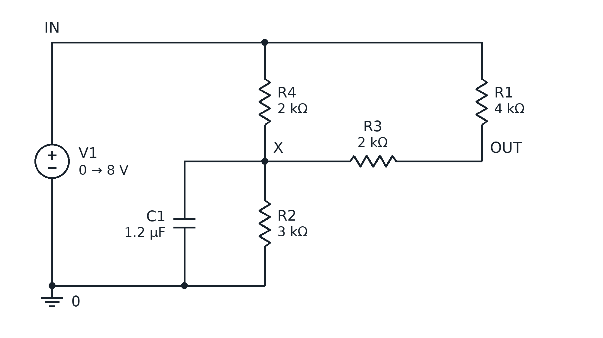](../inputs/P07/schematic.png) | [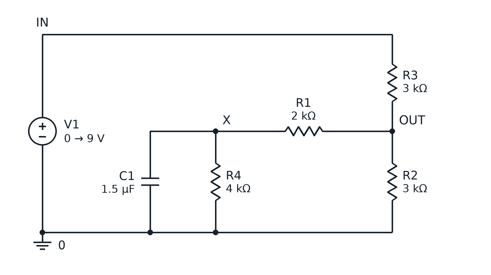](../inputs/P08/schematic.png) | [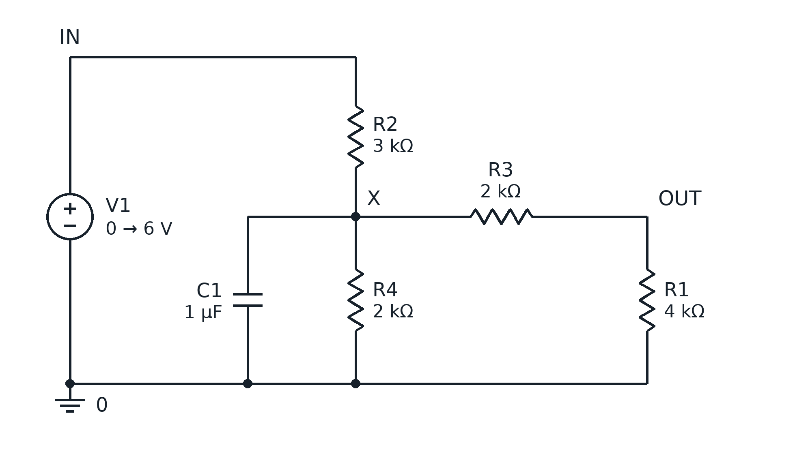](../inputs/P09/schematic.png) |
| **P10** | **P11** | **P12** |
| [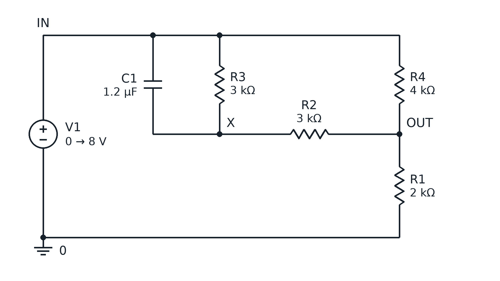](../inputs/P10/schematic.png) | [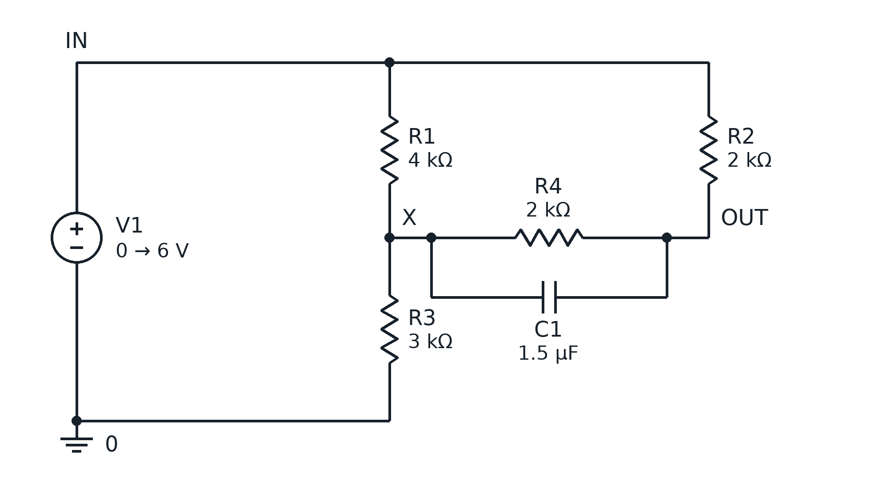](../inputs/P11/schematic.png) | [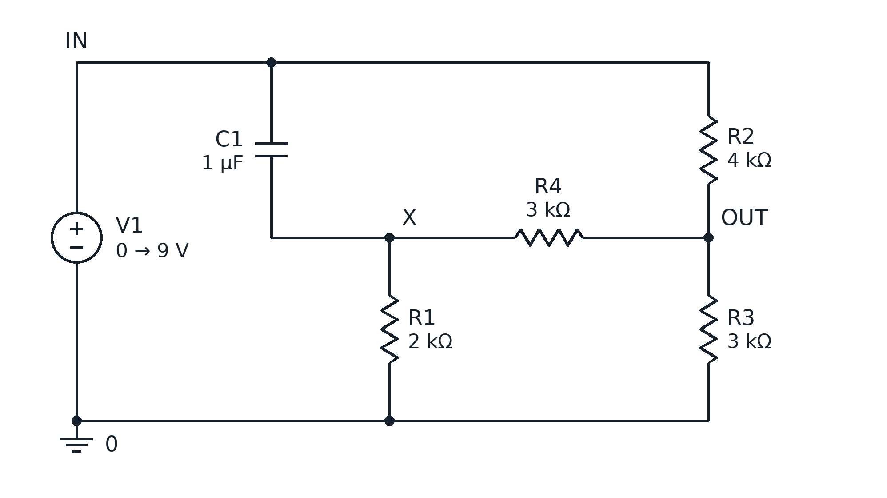](../inputs/P12/schematic.png) |
